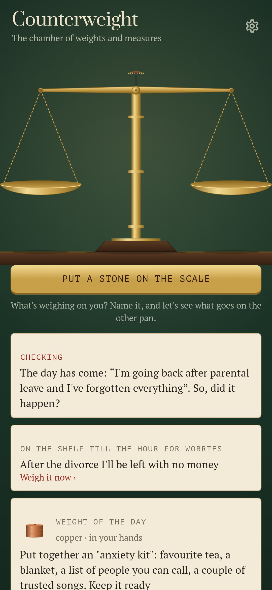
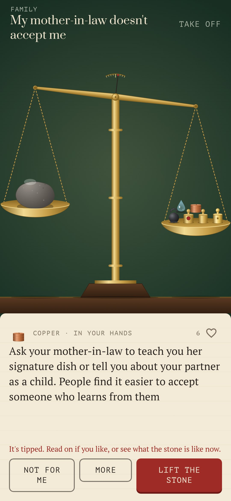
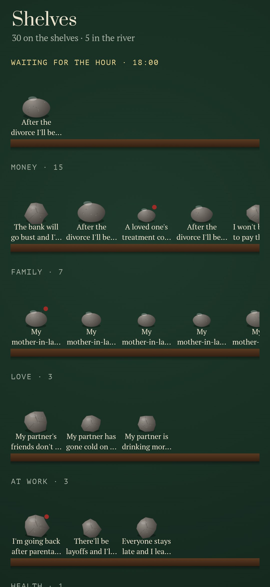
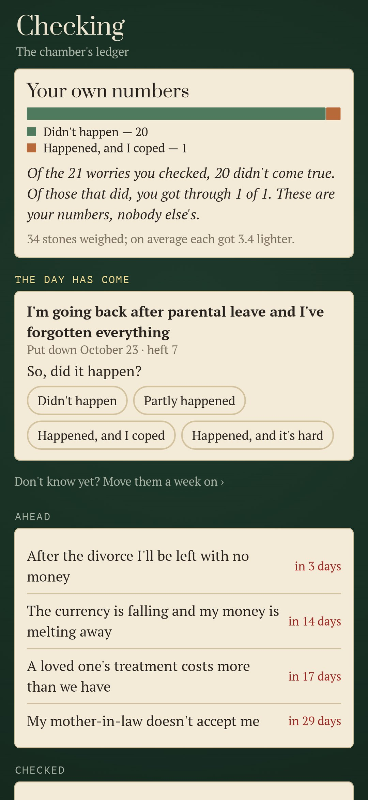
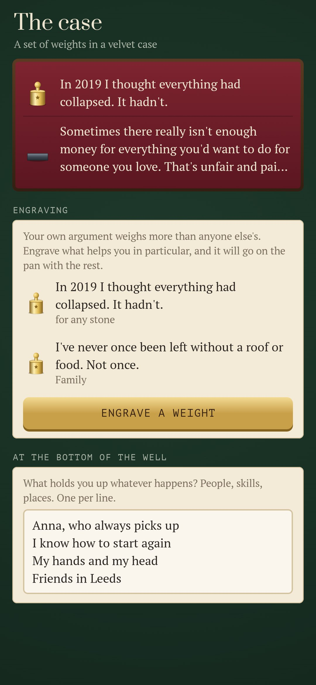

<div align="center">


# Counterweight

### A stone on your heart can be weighed

*Name what won't let you rest: money, test results, the boss who didn't reply, a parent getting old. It goes on the left pan of an old brass balance as a stone. On the right pan the chamber lays weights one by one, each with one argument on it. A weight can be a checked fact, the worst case walked through step by step, one small thing in your hands today, a question, a voice from the Stoics, or a feather. The weights keep coming until the beam tips. 1,209 concrete worries in 24 spheres and 15,900 weights. Free, no ads, no account, no internet.*

[](https://github.com/bigdevwhale/counterweight/actions/workflows/android.yml)


[](LICENSE)

**English** · [Русский](README.ru.md) · [Changelog](CHANGELOG.md)

    

</div>

---

## How it works

1. **The stone.** Type the worry in your own words or pick it from the shelves. Search knows how people really put it: "they'll lay me off", "the mole changed colour". Then say how heavy it feels, from 1 to 10: a grain of sand, a cobblestone, a whole rock.
2. **The weights.** They go on the other pan one at a time, and each metal rings its own note:
   - **cast iron**: facts with a source;
   - **brass**: "and then what?", the worst case step by step down to solid ground;
   - **copper**: one small action within your control;
   - **silver**: the other side;
   - **glass**: a question to ask yourself;
   - **bronze**: voices, from Seneca to the psychologists;
   - **a feather**: a little kind humour.

   Heavy fears that can truly come true get **steel**: honest weights that don't promise it'll all be fine.
3. **The beam tips.** You say how heavy the stone is now, and when it will be clear whether it came true.
4. **Checking the scales.** On that day the chamber asks: so, did it happen? Your own record becomes a sealed weight of its own, for example "You checked 23 worries. 17 didn't happen; of those that did, you got through 6 of 6". Next time it goes on the pan early.
5. **Polishing.** When the same worry is outweighed again and again, its stone on the shelves gets smoother, until it's a pebble you can throw into the river.
6. **The well.** "And then what?" all the way down. At the bottom is what holds you up, in your own words.
7. **The case.**
   - Keep the weights that hit home.
   - Engrave your own; they weigh more than anyone else's.
   - Set aside what isn't for you, and it never comes again.
8. **The hour for worries.** Put a stone on the shelf until evening and don't carry it all day. One quiet bell rings if anything is waiting.
9. **At night.** From midnight to five the chamber is dark and has its own soft weights, because at 3 a.m. the mind exaggerates.
10. **Safety.** Words about self-harm open a help screen with numbers to call, instead of the scale.

The app doesn't replace a doctor or a therapist.

## Build

```
./gradlew testDebugUnitTest assembleDebug
./gradlew -Pdemo assembleDebug          # app.counterweight.demo with two months of weighings
./gradlew testDebugUnitTest -Prender --tests '*RenderArt*'   # the scale, stones, weights, icon and every screen to app/build/art
python tools/shots.py app/build/art     # README screenshots from the renders
python tools/icon.py                    # launcher icon vectors
python tools/check_content.py           # checks the catalogue
```

- **Art.** Everything is drawn in code. The balance, the stones and the ten kinds of weight are in `ui/art/Scale.kt`.
- **Sound.** Sounds are synthesised on first launch.
- **Catalogue.** It lives in `app/src/main/assets/content/`, one TSV per sphere. The format is described in `docs/CONTENT.md`.

Fonts: [Prata](https://fonts.google.com/specimen/Prata), [PT Serif and PT Mono](https://fonts.google.com/?query=PT), SIL Open Font License.
