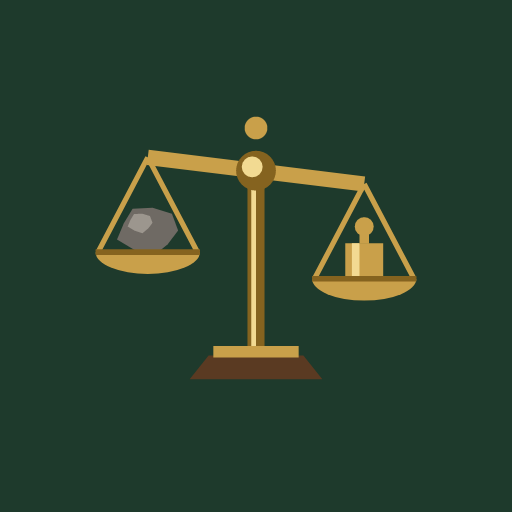
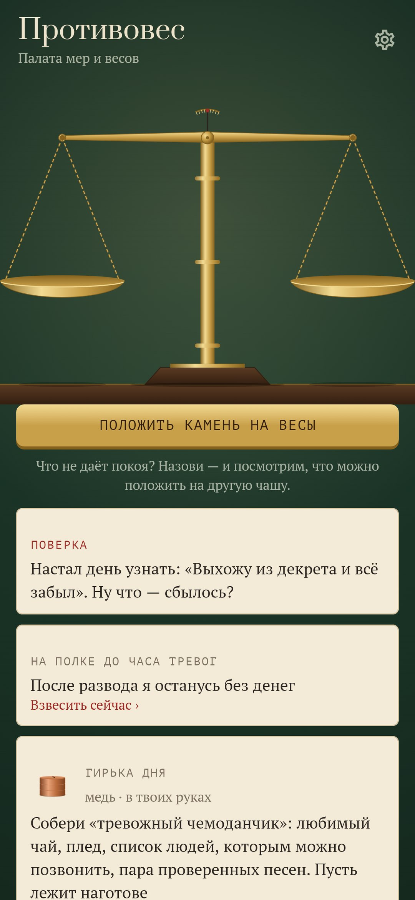
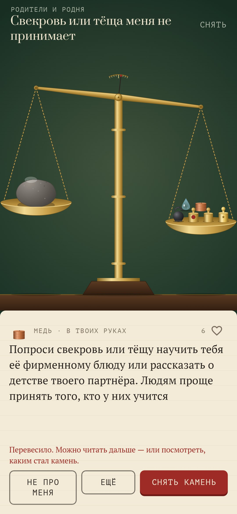
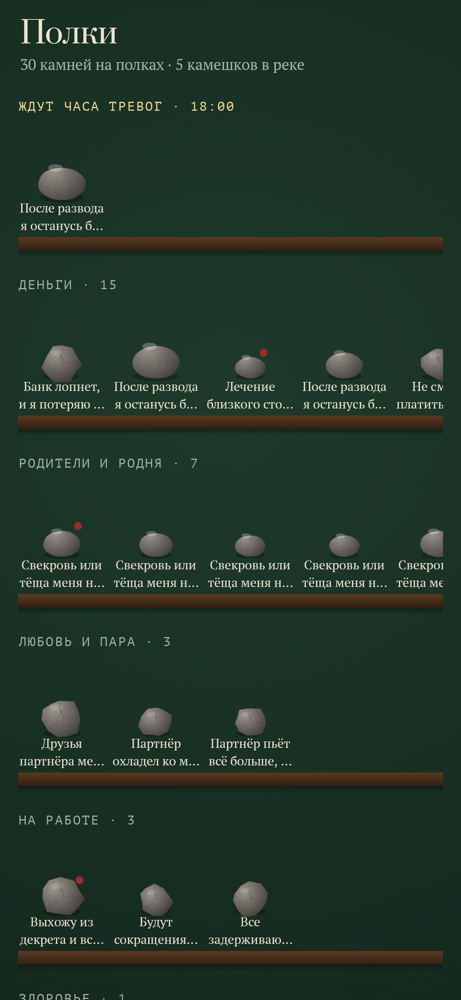
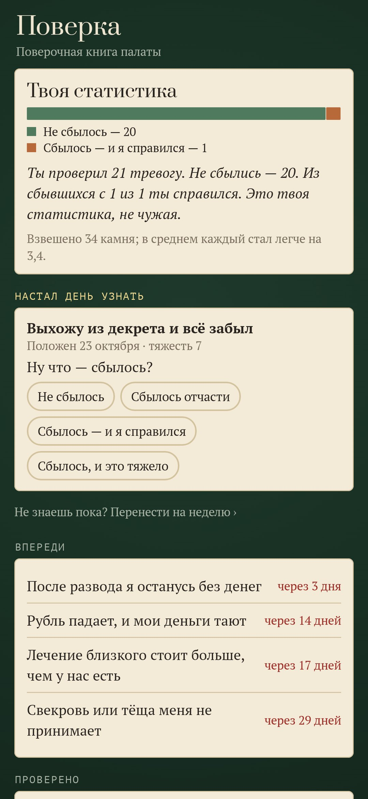
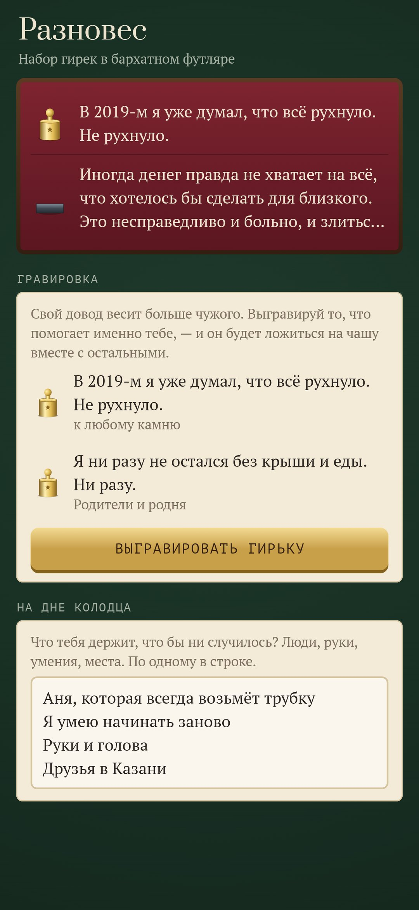

<div align="center">



# Противовес

### Камень на душе можно взвесить

*Назови, что не даёт покоя: деньги, анализы, начальник, который не ответил, стареющие родители. Это ляжет камнем на левую чашу старых латунных весов. На правую чашу палата кладёт гирьки, по одной. На каждой гирьке один довод: проверенный факт, худший случай по шагам, маленькое дело на сегодня, вопрос, голос стоиков или пёрышко. Гирьки ложатся, пока не перевесит. 1 209 конкретных тревог в 24 сферах и 15 900 гирек. Бесплатно, без рекламы, без аккаунта, без интернета.*

[](https://github.com/bigdevwhale/counterweight/actions/workflows/android.yml)


[](LICENSE)

[English](README.md) · **Русский** · [Changelog](CHANGELOG.md)

    

</div>

---

## Как это работает

1. **Камень.** Напиши тревогу своими словами или выбери на полках. Поиск понимает, как люди говорят на самом деле: «попрут с работы», «родинка изменила цвет». Потом скажи, насколько тяжело, от 1 до 10: песчинка, булыжник, скала.
2. **Гирьки.** Они ложатся на другую чашу по одной, и каждый металл звенит по-своему:
   - **чугун** — факты с источником;
   - **латунь** — «и что тогда?», худший случай по шагам до твёрдой земли;
   - **медь** — маленькое дело, которое в твоих руках;
   - **серебро** — другая сторона;
   - **стекло** — вопрос себе;
   - **бронза** — голоса, от Сенеки до психологов;
   - **пёрышко** — немного доброго юмора.

   Тяжёлым страхам, которые правда могут сбыться, достаётся **сталь**: честные гирьки без обещаний, что всё будет хорошо.
3. **Перевесило.** Ты отмечаешь, насколько тяжёл камень теперь и когда станет ясно, сбылось ли.
4. **Поверка весов.** В тот день палата спросит: ну что, сбылось? Твоя собственная статистика отливается в гирьку под сургучом, например: «Ты проверил 23 тревоги. Не сбылись — 17. Из сбывшихся с 6 из 6 ты справился». В следующий раз эта гирька ложится на чашу одной из первых.
5. **Шлифовка.** Если одну и ту же тревогу перевешивают снова и снова, её камень на полках становится глаже. В конце он превращается в гальку, которую можно бросить в реку.
6. **Колодец.** «И что тогда?» до самого дна. На дне лежит то, что тебя держит, твоими словами.
7. **Разновес.**
   - Гирьки, которые попали в точку, можно сохранить в бархатный футляр.
   - Можно выгравировать свои гирьки: свой довод весит больше чужого.
   - Гирька, отложенная как «не про меня», больше не придёт.
8. **Час тревог.** Камень можно положить на полку до вечера и не носить его весь день. Если что-то ждёт на полке, будет одно тихое напоминание.
9. **Ночью.** С полуночи до пяти в палате темно, и у неё свои мягкие гирьки: в три часа ночи голова преувеличивает.
10. **Безопасность.** Слова о том, чтобы навредить себе, открывают вместо весов экран с телефонами помощи.

Приложение не заменяет врача и психотерапевта.

## Сборка

```
./gradlew testDebugUnitTest assembleDebug
./gradlew -Pdemo assembleDebug          # app.counterweight.demo с двумя месяцами взвешиваний
./gradlew testDebugUnitTest -Prender --tests '*RenderArt*'   # весы, камни, гирьки, иконка и все экраны в app/build/art
python tools/shots.py app/build/art     # скриншоты для README
python tools/check_content.py           # проверка каталога
```

- **Графика.** Всё нарисовано в коде, в `ui/art/Scale.kt`.
- **Звук.** Звуки синтезируются при первом запуске.
- **Каталог.** Лежит в `app/src/main/assets/content/`, по одному TSV на сферу. Формат описан в `docs/CONTENT.md`.

Шрифты: Prata, PT Serif и PT Mono, SIL Open Font License.
